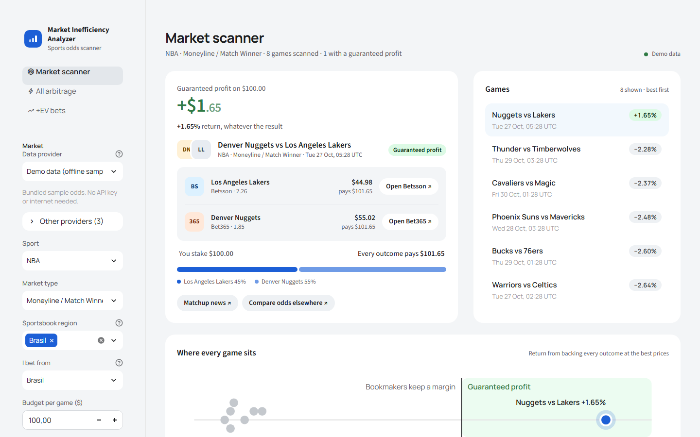
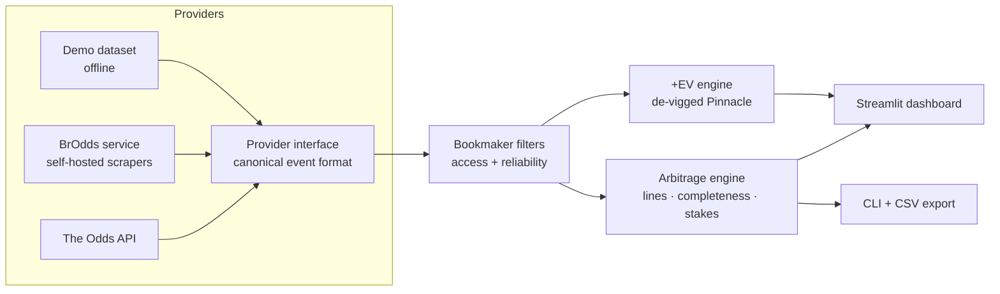

# Market Inefficiency Analyzer

**Finds sports betting markets where bookmakers disagree enough on price that the
disagreement itself is exploitable: guaranteed-profit arbitrage, and bets priced
above their fair value.**

[](https://github.com/PedroMussi14/market-inefficiency-analyzer/actions/workflows/ci.yml)


[](LICENSE)



---

## The problem

Every bookmaker prices each outcome of a match independently, and each adds a
margin so that the implied probabilities of all outcomes sum to *more* than 100%.
Across dozens of bookmakers, though, prices drift apart. Occasionally the **best**
price for each outcome, taken from *different* books, implies probabilities that
sum to **less** than 100%. Staking every outcome in the right proportions then
returns the same amount whatever the result, which is a guaranteed profit.

These windows are small (typically 0.5–3%) and short-lived. Finding them by hand
across hundreds of games, three market types and a dozen bookmakers is not practical.
This project automates the whole process: fetching odds, normalising formats,
pairing comparable bets, doing the maths, and filtering out opportunities that look
real but cannot actually be executed.

## Features

- **Arbitrage detection** for moneyline (2- and 3-way), point spread and totals markets,
  with exact stake sizing, guaranteed profit and ROI.
- **Line-aware matching:** a spread of −3.5 is only ever hedged with +3.5 at the
  other book, never with a different line that would *look* profitable.
- **+EV detection:** compares every bookmaker against Pinnacle's de-vigged
  "sharp" line to find bets priced above their fair probability.
- **Execution filters:** "I bet from…" limits analysis to books available in one
  country (Brazil, USA, UK, Europe). Feeds with known-unreliable prices are
  excluded automatically.
- **Interactive dashboard** (Streamlit + Plotly) with three views: single-sport
  scanner, all-sports arbitrage sweep and +EV bets, plus CSV export.
- **Command-line scanner** for scripting and quick checks.
- **Pluggable data providers:** The Odds API, a self-hosted scraper service for
  Brazilian books ([BrOdds](brodds-api/)), and an **offline demo dataset**, so
  everything runs with no API key and no internet.
- **Tested:** 76 automated tests, including end-to-end tests that drive the real
  dashboard, run on Python 3.11–3.13 in CI.

## Quick start (60 seconds, no API key needed)

```bash
git clone https://github.com/PedroMussi14/market-inefficiency-analyzer.git
cd market-inefficiency-analyzer

python -m venv .venv
# Windows:        .venv\Scripts\activate
# macOS / Linux:  source .venv/bin/activate

pip install -r requirements.txt
streamlit run app.py
```

The dashboard opens at <http://localhost:8501> on the **Demo data** provider:
24 games across the NBA, Premier League, Brasileirão and ATP tennis, priced by 13
bookmakers. Try these:

| Where | What you will see |
|---|---|
| Market Scanner → NBA | Nuggets @ Lakers: a 1.65% guaranteed profit across Betsson and Bet365 |
| Market type → *Game Total* | Heat @ Knicks: an arbitrage on one totals line while other books post different lines |
| ⚡ All Arbitrage | Every opportunity across all sports, including a 3-way soccer arb |
| I bet from → *Anywhere* + region *United States* | A US-only arb appears (DraftKings × FanDuel) |
| 📈 +EV Bets → Brazil Série A | Prices above Pinnacle's fair odds that are *not* arbitrage |

The same analysis from the terminal:

```bash
python -m analyzer --provider demo --sport soccer_epl --regions eu,uk
python -m analyzer --help
```

## Using live odds

Copy `.env.example` to `.env` and add a key from [The Odds API](https://the-odds-api.com)
(the free tier is enough to try it). The dashboard then offers the live provider
alongside the demo.

| Variable | Purpose |
|---|---|
| `API_KEY` | The Odds API key: live odds from 40+ bookmakers worldwide |
| `BRODDS_LOCAL_URL`, `BRODDS_LOCAL_KEY` | Connect to a self-hosted [BrOdds](brodds-api/) instance for Brazilian books |
| `OPTICODDS_KEY` | Reserved for a planned provider |

> Each live request costs quota (markets × regions). The "All Arbitrage" view
> scans every sport, so on the free tier, use it sparingly.

## How it works

For each event, the analyzer:

1. **Collects** every bookmaker's price for every outcome and converts it to decimal odds.
2. **Keeps the best price** per outcome across all bookmakers.
3. **Groups outcomes into lines.** Spreads and totals are only comparable on the same
   line, so Home −3.5 pairs with Away +3.5 and Over 220.5 with Under 220.5.
4. **Checks completeness.** A market missing an outcome (e.g. the draw in soccer)
   can never be a hedge, so it is skipped rather than reported as a false positive.
5. **Sums the implied probabilities** `Σ 1/odds`. Below 1.0 means arbitrage.
6. **Sizes the stakes** so every outcome pays out the same amount.

**Worked example** (from the demo data, $100 budget):

| Outcome | Best price | Book | Implied prob. | Stake | Payout if it wins |
|---|---|---|---|---|---|
| Lakers | 2.26 | Betsson | 44.25% | $44.98 | $101.65 |
| Nuggets | 1.8475 | Bet365 | 54.13% | $55.02 | $101.65 |
| **Total** | | | **98.38%** | **$100.00** | **+$1.65 guaranteed** |

The full derivation, the +EV method and the data-quality pitfalls are in
[docs/methodology.md](docs/methodology.md).

## Architecture



The core (`analyzer/`) is plain Python with no UI dependencies, so the same
logic powers the dashboard, the CLI and the tests. Design decisions are covered in
[docs/architecture.md](docs/architecture.md).

```
├── app.py                  Streamlit entry point
├── analyzer/               core library (no UI code)
│   ├── odds.py             odds conversion, implied probability
│   ├── arbitrage.py        best prices, line grouping, stakes, profit
│   ├── ev.py               +EV against Pinnacle's fair line
│   ├── filters.py          "I bet from" and reliability filters
│   ├── export.py           DataFrame / CSV export
│   ├── cli.py              command-line scanner
│   ├── providers/          The Odds API · BrOdds · demo · planned
│   └── data/demo/          bundled sample odds
├── dashboard/              Streamlit UI: theme, charts, components, sidebar, views/
├── brodds-api/             FastAPI + PostgreSQL scraper service for Brazilian books
├── scripts/                demo data generator
├── tests/                  pytest suite (unit + end-to-end dashboard tests)
└── docs/                   methodology and architecture
```

## Testing and quality

```bash
pip install -r requirements-dev.txt
pytest                      # analyzer + dashboard (73 tests)
ruff check .                # lint
cd brodds-api && pytest     # scraper service (3 tests, own dependencies)
```

- **Regression tests** for every bug fixed, e.g. spread lines being mixed, or a
  missing draw price producing a false "guaranteed" profit.
- **End-to-end dashboard tests** run the real Streamlit app on demo data and check
  what each page shows.
- **Self-verifying demo data:** `scripts/generate_demo_data.py` builds the dataset
  from fair probabilities, bookmaker margins and seeded noise, then confirms with the
  real analyzer that exactly the planted opportunities, and nothing else, are detected.
- **CI** (GitHub Actions) runs lint and all suites on every push.

## Limitations and responsible use

This is an analysis tool, not betting advice. Real-world arbitrage carries risks the
maths alone does not capture:

- **Prices move.** Odds can change between the scan and placing each bet; a partial
  fill leaves an unhedged position.
- **Bookmakers restrict arbitrage players** by limiting stakes or closing accounts.
- **Feeds can be stale or wrong.** The reliability filter removes known offenders,
  but a price that looks too good usually is.
- **Exchange commission and bet limits** are not modelled yet.

Gambling involves risk. Check the law where you live and bet responsibly.

## Roadmap

- [ ] Model exchange commission and per-book maximum stakes
- [ ] Flag stale prices using each bookmaker's `last_update` timestamp
- [ ] Line-movement history and alerts from BrOdds' odds snapshots
- [ ] More BrOdds scrapers (KTO, Sportingbet, …) and the OpticOdds adapter

## Author

**Pedro Mussi**, [GitHub](https://github.com/PedroMussi14)

Released under the [MIT License](LICENSE).
