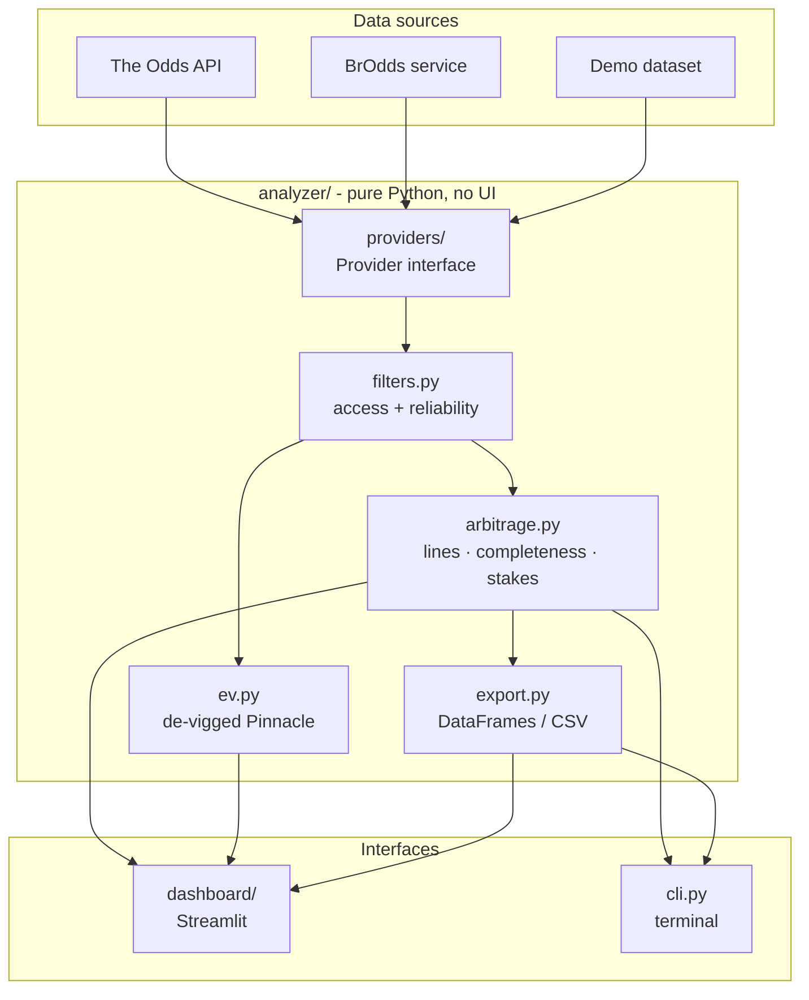

# Architecture

How the project is organised, how data flows through it, and why it is built
this way.

## Overview



The project has three layers:

| Layer | Package | Depends on |
|---|---|---|
| Data sources | `analyzer/providers/` | HTTP APIs or bundled files |
| Analysis core | `analyzer/` | Python standard library and pandas |
| Interfaces | `dashboard/`, `analyzer/cli.py` | the core |

Dependencies only point downwards: the core never imports Streamlit. That is
why the CLI, the dashboard and the tests all exercise exactly the same logic.

## Canonical event format

Every provider returns events in one shape, the response format of
**The Odds API v4**:

```json
{
  "id": "…", "sport_key": "basketball_nba", "sport_title": "NBA",
  "commence_time": "2026-10-27T02:00:00Z",
  "home_team": "Los Angeles Lakers", "away_team": "Denver Nuggets",
  "bookmakers": [{
    "key": "betsson", "title": "Betsson",
    "markets": [{
      "key": "spreads",
      "outcomes": [
        {"name": "Los Angeles Lakers", "price": -110, "point": -1.5},
        {"name": "Denver Nuggets",     "price": -110, "point":  1.5}
      ]
    }]
  }]
}
```

Using an existing public format, rather than inventing one, means:

- The Odds API needs no transformation at all.
- The BrOdds service exposes the same format, so it is a drop-in replacement.
- Fixtures in tests look exactly like real responses.

## Providers

`analyzer/providers/base.py` defines the interface:

```python
class Provider(ABC):
    name: str; label: str; region_hint: str
    def get_sports(self) -> list: ...
    def get_odds(self, sport, markets="h2h", regions="us", ...) -> list: ...
    def get_quota_info(self) -> dict: ...      # optional
    def is_configured(self) -> bool: ...       # e.g. API key present
```

| Provider | Module | Notes |
|---|---|---|
| The Odds API | `odds_api.py` | Live data; tracks request quota from response headers |
| Demo | `demo.py` | Bundled data; always configured; start times relative to now |
| BrOdds | `brodds.py` | Thin HTTP client for the self-hosted service |
| OpticOdds | `planned.py` | Registered placeholder, not implemented |

The registry in `providers/__init__.py` lists them in priority order. The first
*configured* provider is the default, so a fresh clone with no `.env` falls
back to the demo data automatically.

Adding a provider means writing one class and adding it to the list. Nothing in
the analysis or UI changes.

## Analysis pipeline

For each event (`analyzer/arbitrage.py`):

1. `get_best_odds_for_event` keeps the best price per outcome key. For spreads
   and totals, the key includes the line, e.g. `"Lakers|-1.5"`.
2. `_group_into_lines` pairs complementary outcomes on the same line.
3. `_expected_outcome_count` rejects incomplete markets (e.g. soccer without a draw).
4. Each complete line is scored by its implied probability sum; the best is kept.
5. If it is an arbitrage, stakes, profit and ROI are attached.

`analyze_event` returns a plain dict, so results are easy to export, test
and display. See [methodology.md](methodology.md) for the maths.

Filtering (`analyzer/filters.py`) runs **before** analysis, not after. Removing
an inaccessible bookmaker can change which price is "best", so filtering
afterwards would give wrong answers.

## Dashboard

```
app.py               page config → inject_css() → render_sidebar() → VIEWS[page](settings)
dashboard/
├── sidebar.py       draws controls, returns a frozen Settings dataclass
├── data.py          @st.cache_data loaders (fetch → filter → analyse)
├── views/           scanner.py · all_arbitrage.py · ev_bets.py, each exposes render(settings)
├── components.py    cards, badges, prices table, bookmaker links (escapes provider text)
├── charts.py        Plotly figures
├── theme.py         colour tokens + CSS, shared by charts and HTML
└── config.py        options and thresholds
```

Design choices:

- **One `Settings` object.** Views receive everything the user chose as one
  typed value, instead of reading dozens of module-level globals.
- **Caching by plain arguments.** Loaders take hashable arguments (provider
  name, sport, market, region, filter preset), so Streamlit caches each
  combination separately. Live data is cached for 60–300 seconds to protect
  API quota.
- **Parallel all-sports scan.** "All Arbitrage" fetches sports concurrently
  with a thread pool. Sports that fail to load are reported, not silently dropped.
- **Untrusted text is escaped.** Team and bookmaker names come from external
  APIs and are HTML-escaped before being rendered as HTML.

## Demo data

`scripts/generate_demo_data.py` produces the files in `analyzer/data/demo/`:

1. Each event has fair outcome probabilities.
2. Each of 13 bookmakers prices it with its own margin plus seeded random
   disagreement, and posts its own spread/total line.
3. Specific opportunities are planted: arbitrage on moneyline, 3-way soccer
   and totals, a US-only arbitrage, a +EV price, and a phantom 1xBet price.
4. The script runs the **real analyzer** over the result and fails unless
   exactly the planted opportunities are detected.

The output is deterministic (fixed seed), so regenerating it is reproducible.

## BrOdds service

Brazilian bookmakers such as Betano are not covered by commercial odds APIs, so
[`brodds-api/`](../brodds-api/README.md) is a separate service:

```
APScheduler → scrapers (Playwright) → team-name normaliser → PostgreSQL → FastAPI (Odds API v4 format)
```

It runs in Docker Compose (PostgreSQL, Redis, API, scheduler) and has its own
dependencies and test suite. The analyzer talks to it only over HTTP through
`BroddsLocalProvider`.

## Testing strategy

| Level | Examples | Location |
|---|---|---|
| Unit | odds conversion, stake maths, line grouping, filters | `tests/test_*.py` |
| Regression | one test per fixed bug (mixed lines, missing draw, …) | `tests/test_arbitrage.py`, `tests/test_ev.py` |
| Integration | CLI end to end, demo provider schema | `tests/test_cli_and_providers.py`, `tests/test_demo_provider.py` |
| End to end | real Streamlit app driven by `AppTest` on demo data | `tests/test_dashboard.py` |
| Service | scheduler and Betano parser | `brodds-api/tests/` |

CI (`.github/workflows/ci.yml`) runs ruff, the analyzer suite on Python
3.11–3.13, and the BrOdds suite against its own pinned dependencies.
